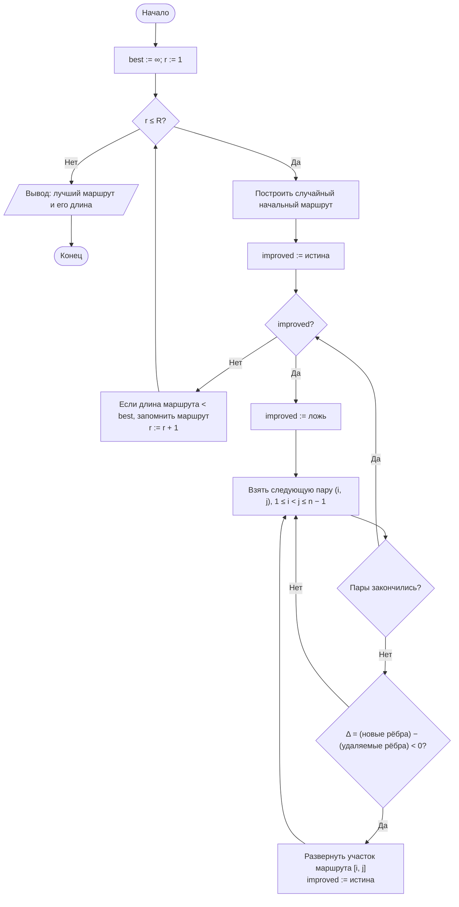
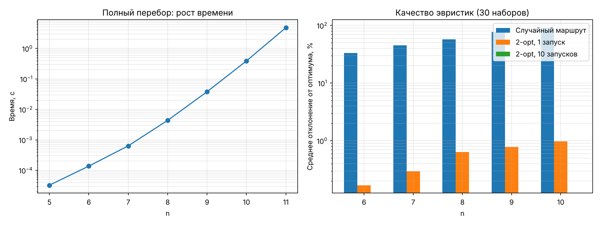
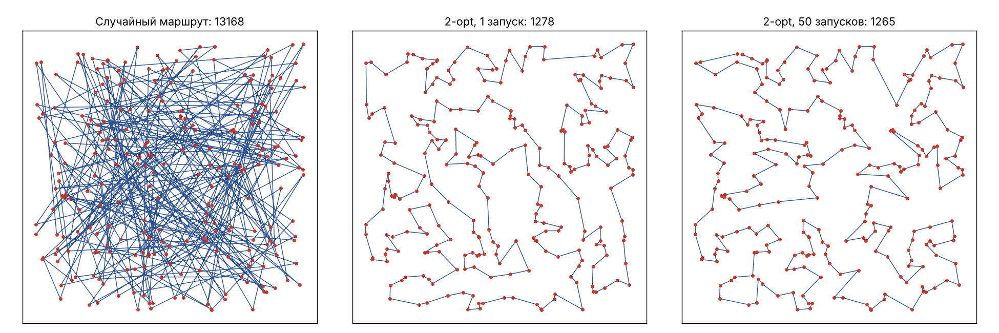

# Отчёт по лабораторной работе № 12

## Точные и эвристические алгоритмы решения труднорешаемых задач комбинаторной оптимизации

---

## 1. Титульный лист

| | |
|---|---|
| **Дисциплина** | Теория алгоритмов |
| **Направление подготовки** | 38.03.05 «Бизнес-информатика» |
| **Курс** | 2 |
| **Лабораторная работа** | № 12. Точные и эвристические алгоритмы решения труднорешаемых задач комбинаторной оптимизации |
| **Вариант** | 19 |
| **Выполнила** | Ситникова Ольга Алексеевна, группа БИ2-1 |
| **Проверил** | ______________________ |
| **Год** | 2026 |

---

## 2. Цель работы и задание варианта

**Цель работы:** изучить класс задач, для которых точные алгоритмы практически неприменимы, и освоить приёмы построения приближённых решений — конструктивные эвристики и локальный поиск.

**Задание варианта 19:**

| Параметр | Значение |
|---|---|
| Задача | коммивояжёр (города на плоскости) |
| Точный метод | полный перебор |
| Конструктивная эвристика | случайный маршрут |
| Локальный поиск | 2-opt с многократным запуском |
| Размерности | 5…10 (точное решение), 250 (эвристики) |
| Дополнительное задание | М5 — визуализировать маршрут до и после локального поиска средствами `matplotlib` |

**Что выполнено:**

1. Реализованы полный перебор, случайный маршрут и локальный поиск 2-opt с многократным запуском из случайных начальных маршрутов.
2. Измерено время полного перебора при росте n (до n = 11), определено предельное n, при котором расчёт укладывается в 10 с.
3. На малых размерностях n = 6…10 вычислены отклонения эвристик от точного оптимума по 30 наборам данных для каждого n.
4. На задаче с 250 городами сравнены случайный маршрут, один запуск 2-opt и 50 запусков по качеству и времени.
5. Выполнено дополнительное задание М5: построены рисунки маршрутов до и после локального поиска.

---

## 3. Постановка задачи и обоснование её принадлежности к классу NP-трудных

**Постановка.** Дано n городов с координатами на плоскости и матрица D евклидовых расстояний. Требуется найти замкнутый маршрут, проходящий через каждый город ровно один раз, с минимальной суммарной длиной. Города генерируются случайно в квадрате 100 × 100.

**Размер пространства поиска.** Число различных замкнутых маршрутов при фиксированном начальном городе равно (n − 1)! для направленных маршрутов и (n − 1)! / 2 для симметричной матрицы (маршрут и его обращение имеют одну длину). Для n = 250 это число порядка 10⁴⁹⁰ (при полном переборе рассматриваются (n − 1)! ≈ 1,29 · 10⁴⁹⁰ перестановок).

**Обоснование NP-трудности.**

1. **Задача распознавания** «существует ли замкнутый маршрут длиной не более K» принадлежит классу NP: предъявленный маршрут проверяется за время Θ(n) — достаточно сложить длины n рёбер и сравнить с K.
2. **NP-полнота.** Задача о гамильтоновом цикле (есть ли в графе цикл, проходящий через все вершины ровно один раз) NP-полна. Она сводится к задаче коммивояжёра за полиномиальное время: по графу G строится полный граф с расстояниями 1 для рёбер G и 2 для остальных пар вершин; маршрут длиной ровно n существует тогда и только тогда, когда в G есть гамильтонов цикл (K = n). Следовательно, задача распознавания NP-полна.
3. **Оптимизационная постановка** (найти кратчайший маршрут) не легче задачи распознавания, поэтому она NP-трудна. Трудна и евклидова версия задачи — города на плоскости (результаты Гэри, Грэхема, Джонсона, 1976, и Пападимитриу, 1977).

Практический вывод: если не выполняется равенство P = NP, то для задачи коммивояжёра не существует точного алгоритма с полиномиальным временем работы, и при больших n разумной стратегией является поиск приближённого решения.

---

## 4. Описание точного алгоритма и эвристик

### 4.1. Точный алгоритм: полный перебор

Первый город фиксируется (маршрут замкнут, поэтому выбор стартового города не влияет на длину). Перебираются все (n − 1)! перестановок остальных городов, для каждого маршрута вычисляется длина (Θ(n)), запоминается лучший. Трудоёмкость Θ(n · (n − 1)!) = Θ(n!). Метод гарантирует точный оптимум, но применим только при n ≲ 11 (раздел 7).

### 4.2. Конструктивная эвристика: случайный маршрут

Города записываются в случайном порядке (перемешивание, Θ(n)). Метод не использует расстояния и не даёт гарантий качества; он служит нижней точкой отсчёта и источником начальных решений для локального поиска. Ожидаемая длина случайного маршрута равна n · d, где d — среднее расстояние между двумя случайными точками квадрата 100 × 100 (около 52,14): для n = 250 ожидаемая длина около 13 035.

### 4.3. Локальный поиск 2-opt

Из маршрута удаляются два ребра, а участок между ними разворачивается. Для индексов 1 ≤ i < j ≤ n − 1 изменение длины равно

Δ = D[t[i−1]][t[j]] + D[t[i]][t[j+1]] − D[t[i−1]][t[i]] − D[t[j]][t[j+1]],

где t — маршрут, индексы берутся по модулю n. Если Δ < 0, разворот участка t[i..j] принимается. Один проход по всем парам (i, j) требует Θ(n²) операций (на каждую пару — O(1) операций, так как пересчитываются только 4 ребра). Проходы повторяются, пока в очередном проходе есть улучшения (но не более 100 проходов). Алгоритм заканчивается: каждое принятое изменение строго уменьшает длину, а число маршрутов конечно. Результат — **локальный оптимум**: решение, которое нельзя улучшить разворотом ни одного участка, но которое может быть длиннее глобального оптимума. В евклидовой задаче в локальном оптимуме 2-opt нет пересекающихся рёбер.

### 4.4. Многократный запуск

Один запуск зависит от начального маршрута. Поэтому 2-opt запускается R раз из независимых случайных маршрутов, и из R найденных локальных оптимумов выбирается наилучший. Лучшая длина не возрастает с ростом R, время растёт пропорционально R. В работе: R = 10 на малых размерностях и R = 50 при n = 250.

### 4.5. Оценка качества

Для малых n отклонение эвристики от точного оптимума: δ = (L − L_опт) / L_опт · 100 %, где L — длина маршрута эвристики, L_опт — оптимальная длина по полному перебору. Также оценивается доля наборов, на которых эвристика достигла оптимума.

---

## 5. Блок-схема локального поиска

Блок-схема 2-opt с многократным запуском (R — число запусков):



---

## 6. Листинг программы

Файл `lab12_variant19.py` (Python 3.10+, для графиков нужна библиотека `matplotlib`). Каждая строка снабжена комментарием.

```python
"""Лабораторная работа № 12. Вариант 19. Ситникова Ольга Алексеевна."""
import math  # расстояния и факториал
import platform  # сведения о компьютере
import random  # случайные города и маршруты
import statistics  # среднее значение
import time  # замер времени
from itertools import permutations  # перебор маршрутов
import matplotlib.pyplot as plt  # графики и визуализация маршрутов

N_BIG, TRIALS, RUNS_SMALL, RUNS_BIG = 250, 30, 10, 50  # размерность для эвристик, число наборов, запусков 2-opt на малых и большой размерностях


def generate_cities(n, seed=42):  # n случайных городов на плоскости 100 × 100
    rng = random.Random(seed)  # генератор с фиксированным seed
    return [(rng.uniform(0, 100), rng.uniform(0, 100)) for _ in range(n)]  # список координат


def distance_matrix(cities):  # матрица евклидовых расстояний
    n = len(cities)  # число городов
    D = [[0.0] * n for _ in range(n)]  # матрица из нулей
    for i in range(n):  # перебираем пары городов
        for j in range(i + 1, n):  # только i < j (матрица симметрична)
            D[i][j] = D[j][i] = math.dist(cities[i], cities[j])  # расстояние между городами
    return D  # матрица расстояний


def tour_length(tour, D):  # длина замкнутого маршрута
    return sum(D[tour[i]][tour[(i + 1) % len(tour)]] for i in range(len(tour)))  # сумма рёбер с возвратом в начало


def brute_force(D):  # точный алгоритм: полный перебор, Θ(n!); первый город фиксирован
    best_tour, best_len = None, float("inf")  # лучший найденный маршрут
    for perm in permutations(range(1, len(D))):  # все порядки остальных городов
        tour = (0,) + perm  # маршрут начинается с города 0
        length = tour_length(tour, D)  # длина маршрута
        if length < best_len:  # найден более короткий маршрут
            best_tour, best_len = tour, length  # запоминаем его
    return list(best_tour), best_len  # оптимальный маршрут и его длина


def random_tour(n, rng):  # конструктивная эвристика: случайный маршрут, Θ(n)
    tour = list(range(n))  # города в порядке номеров
    rng.shuffle(tour)  # случайная перестановка
    return tour  # маршрут


def two_opt(tour, D, max_passes=100):  # локальный поиск в окрестности 2-opt
    n, tour = len(tour), tour[:]  # число городов и копия маршрута
    for _ in range(max_passes):  # проходы повторяются, пока есть улучшения
        improved = False  # в этом проходе улучшений пока нет
        for i in range(1, n - 1):  # начало разворачиваемого участка
            for j in range(i + 1, n):  # конец разворачиваемого участка
                delta = (D[tour[i - 1]][tour[j]] + D[tour[i]][tour[(j + 1) % n]]  # новые рёбра
                         - D[tour[i - 1]][tour[i]] - D[tour[j]][tour[(j + 1) % n]])  # минус удаляемые рёбра
                if delta < -1e-12:  # длина уменьшается
                    tour[i:j + 1] = reversed(tour[i:j + 1])  # разворачиваем участок i…j
                    improved = True  # улучшение найдено
        if not improved:  # локальный оптимум достигнут
            break  # выходим
    return tour, tour_length(tour, D)  # маршрут и его длина


def multi_start(D, runs, rng):  # 2-opt с многократным запуском из случайных начальных маршрутов
    best_tour, best_len, history, lengths = None, float("inf"), [], []  # лучший результат, история лучшей длины и длины всех запусков
    for _ in range(runs):  # несколько запусков
        tour, length = two_opt(random_tour(len(D), rng), D)  # запуск из нового случайного маршрута
        if length < best_len:  # результат лучше прежнего
            best_tour, best_len = tour, length  # запоминаем
        history.append(best_len)  # лучшая длина после очередного запуска
        lengths.append(length)  # длина результата этого запуска
    return best_tour, best_len, history, lengths  # лучший маршрут, длина, история и длины запусков


def draw(ax, cities, tour, title):  # рисунок маршрута на плоскости (М5)
    pts = [cities[c] for c in tour + [tour[0]]]  # координаты городов маршрута с возвратом в начало
    ax.plot([p[0] for p in pts], [p[1] for p in pts], "-", color="#2f5496", linewidth=0.8)  # линия маршрута
    ax.scatter([c[0] for c in cities], [c[1] for c in cities], s=8, color="#c0392b", zorder=3)  # города
    ax.set(title=title, aspect="equal", xticks=[], yticks=[])  # оформление


if __name__ == "__main__":  # запуск только при прямом старте файла
    print(platform.platform(), "|", platform.processor() or platform.machine(), "| Python", platform.python_version())  # система
    print("\n   n | маршрутов (n-1)! | полный перебор, с")  # заголовок таблицы
    ns, times = [], []  # размеры и времена для графика
    for n in range(5, 12):  # размерности, доступные полному перебору
        D = distance_matrix(generate_cities(n))  # случайные города
        t0 = time.perf_counter()  # начало замера
        brute_force(D)  # полный перебор
        times.append(time.perf_counter() - t0)  # время перебора
        ns.append(n)  # размер
        print(f"{n:>4} | {math.factorial(n - 1):>16} | {times[-1]:>17.4f}")  # строка таблицы
    c = times[-1] / math.factorial(ns[-1] - 1)  # время на один маршрут (по последнему измерению)
    for n in (12, 13, 15, 20):  # оценка времени для больших n
        print(f"{n:>4} | {math.factorial(n - 1):>16} | оценка {c * math.factorial(n - 1):.3e} с")  # экстраполяция
    print(f"\nОтклонение от оптимума по {TRIALS} наборам (2-opt: один запуск и {RUNS_SMALL} запусков)")  # заголовок
    print("   n | случайный, % | 2-opt, % (оптимум) | многократный, % (оптимум)")  # заголовок таблицы
    dev_table = {}  # отклонения для графика
    for n in range(6, 11):  # малые размерности
        dev, hits = {"rand": [], "one": [], "multi": []}, {"one": 0, "multi": 0}  # отклонения и число попаданий в оптимум
        for trial in range(TRIALS):  # серия наборов данных
            D, rng = distance_matrix(generate_cities(n, seed=100 + trial)), random.Random(trial)  # набор и свой генератор
            opt = brute_force(D)[1]  # точный оптимум
            start = random_tour(n, rng)  # случайный маршрут
            l_one = two_opt(start, D)[1]  # 2-opt из этого маршрута
            l_multi = multi_start(D, RUNS_SMALL, rng)[1]  # многократный запуск
            for key, length in (("rand", tour_length(start, D)), ("one", l_one), ("multi", l_multi)):  # три метода
                dev[key].append((length - opt) / opt * 100)  # отклонение в процентах
            hits["one"] += abs(l_one - opt) < 1e-9  # 2-opt достиг оптимума
            hits["multi"] += abs(l_multi - opt) < 1e-9  # многократный запуск достиг оптимума
        dev_table[n] = [statistics.mean(dev[k]) for k in ("rand", "one", "multi")]  # средние отклонения
        print(f"{n:>4} | {dev_table[n][0]:>12.2f} | {dev_table[n][1]:>8.2f} ({hits['one'] / TRIALS * 100:>4.0f} %) | {dev_table[n][2]:>10.2f} ({hits['multi'] / TRIALS * 100:>4.0f} %)")  # строка
    cities, rng = generate_cities(N_BIG), random.Random(0)  # города и генератор для большой размерности
    D = distance_matrix(cities)  # матрица расстояний
    start = random_tour(N_BIG, rng)  # случайный маршрут
    t0 = time.perf_counter()  # начало замера одного запуска
    tour_one, l_one = two_opt(start, D)  # 2-opt из случайного маршрута
    t_one = time.perf_counter() - t0  # время одного запуска
    t0 = time.perf_counter()  # начало замера многократного запуска
    tour_multi, l_multi, history, lengths = multi_start(D, RUNS_BIG, rng)  # многократный запуск
    t_multi = time.perf_counter() - t0  # время многократного запуска
    print(f"\nN = {N_BIG} городов:")  # заголовок большой размерности
    print(f"  случайный маршрут: длина {tour_length(start, D):9.1f}")  # длина случайного маршрута
    print(f"  2-opt (1 запуск):  длина {l_one:9.1f}, время {t_one:.4f} с")  # один запуск
    print(f"  2-opt ({RUNS_BIG} запусков): длина {l_multi:9.1f}, время {t_multi:.4f} с")  # многократный запуск
    print("  лучшая длина после запусков 1, 5, 10, 25, 50:", [round(history[k - 1], 1) for k in (1, 5, 10, 25, 50)])  # история
    print(f"  длины {RUNS_BIG} одиночных запусков: среднее {statistics.mean(lengths):.1f}, минимум {min(lengths):.1f}, максимум {max(lengths):.1f}")  # разброс запусков
    lg = math.lgamma(N_BIG) / math.log(10)  # log10((N-1)!) — само число не помещается в float
    print(f"  число маршрутов полного перебора (N-1)! ≈ {10 ** (lg % 1):.2f} · 10^{int(lg)}")  # размер пространства поиска
    fig, (ax1, ax2) = plt.subplots(1, 2, figsize=(12, 4.5))  # два графика рядом
    ax1.plot(ns, times, "o-")  # время полного перебора
    ax1.set(xlabel="n", ylabel="Время, с", title="Полный перебор: рост времени", yscale="log")  # оформление
    xs = list(dev_table)  # размерности
    for k, (label, off) in enumerate((("Случайный маршрут", -0.27), ("2-opt, 1 запуск", 0), (f"2-opt, {RUNS_SMALL} запусков", 0.27))):  # три набора столбцов
        ax2.bar([x + off for x in xs], [dev_table[x][k] for x in xs], 0.27, label=label)  # столбцы отклонений
    ax2.set(xlabel="n", ylabel="Среднее отклонение от оптимума, %", title=f"Качество эвристик ({TRIALS} наборов)", yscale="log")  # оформление
    for ax in (ax1, ax2):  # общее оформление
        ax.grid(True, alpha=0.3, which="both")  # сетка
    ax2.legend()  # легенда
    plt.tight_layout()  # убираем наложение подписей
    plt.savefig("lab12_graphs.png", dpi=150)  # сохраняем графики для отчёта
    fig, axes = plt.subplots(1, 3, figsize=(15, 5))  # визуализация маршрутов (М5)
    draw(axes[0], cities, start, f"Случайный маршрут: {tour_length(start, D):.0f}")  # до локального поиска
    draw(axes[1], cities, tour_one, f"2-opt, 1 запуск: {l_one:.0f}")  # после одного запуска
    draw(axes[2], cities, tour_multi, f"2-opt, {RUNS_BIG} запусков: {l_multi:.0f}")  # после многократного запуска
    plt.tight_layout(rect=[0, 0, 1, 0.94])  # оставляем место под заголовки рисунков
    plt.savefig("lab12_routes.png", dpi=130)  # сохраняем рисунок маршрутов
    plt.show()  # показываем графики на экране
```

---

## 7. Рост времени точного метода и график

**Условия измерений:** Linux (Ubuntu 24.04), Intel Xeon @ 2,10 ГГц (1 виртуальное ядро), 3 ГБ ОЗУ, Python 3.12.3, matplotlib 3.11. Города — случайные точки квадрата 100 × 100 (`seed = 42`), время измерено функцией `time.perf_counter()`.

**Таблица 1. Время полного перебора**

| n | Число маршрутов (n − 1)! | Время, с | Примечание |
|---|---|---|---|
| 5 | 24 | < 0,0001 | измерено |
| 6 | 120 | 0,0001 | измерено |
| 7 | 720 | 0,0006 | измерено |
| 8 | 5040 | 0,0044 | измерено |
| 9 | 40 320 | 0,0380 | измерено |
| 10 | 362 880 | 0,3907 | измерено |
| 11 | 3 628 800 | 4,8244 | измерено |
| 12 | 39 916 800 | ≈ 53 | оценка |
| 13 | 479 001 600 | ≈ 637 (около 11 мин) | оценка |
| 15 | 8,7 · 10¹⁰ | ≈ 1,2 · 10⁵ (около 32 ч) | оценка |
| 20 | 1,2 · 10¹⁷ | ≈ 1,6 · 10¹¹ (около 5 100 лет) | оценка |

Оценки для n ≥ 12 получены экстраполяцией: время одного маршрута, найденное по n = 11 (≈ 1,33 мкс), умножено на (n − 1)!.

**Предельное n.** Последний размер, укладывающийся в 10 с, — **n = 11** (4,8 с). Для n = 12 оценка составляет около 53 с, что превышает ориентир. Каждое увеличение n на единицу умножает время примерно в n раз: при переходе от 9 к 10 городам — в 10,3 раза, от 10 к 11 — в 12,3 раза, что согласуется с оценкой Θ(n!). Для n = 250 полный перебор невозможен принципиально: число маршрутов около 10⁴⁹⁰.

**График** (слева — время полного перебора в логарифмической шкале; справа — отклонения эвристик из раздела 8):



---

## 8. Отклонение эвристик от оптимума на малых размерностях

Для каждого n = 6…10 сгенерировано по 30 наборов городов (`seed` от 100 до 129). Для каждого набора точный оптимум найден полным перебором и сопоставлен с тремя результатами: один случайный маршрут, один запуск 2-opt из этого маршрута, 10 запусков 2-opt (лучший результат).

**Таблица 2. Среднее отклонение от оптимума, % (в скобках — доля наборов, где найден точный оптимум)**

| n | Случайный маршрут | 2-opt, 1 запуск | 2-opt, 10 запусков |
|---|---|---|---|
| 6 | 33,21 | 0,17 (90 %) | 0,00 (100 %) |
| 7 | 45,26 | 0,29 (90 %) | 0,00 (100 %) |
| 8 | 56,98 | 0,64 (80 %) | 0,00 (100 %) |
| 9 | 77,18 | 0,78 (73 %) | 0,00 (100 %) |
| 10 | 91,44 | 0,97 (70 %) | 0,00 (100 %) |

**Анализ.**

- Случайный маршрут в среднем на 33–91 % длиннее оптимума, и отклонение растёт с n (при росте n увеличивается доля «плохих» перестановок).
- Один запуск 2-opt снижает отклонение до 0,17–0,97 %, то есть почти до оптимума, но доля наборов с точным оптимумом падает с 90 % до 70 % при росте n от 6 до 10: чем больше городов, тем больше локальных оптимумов, в которых поиск может «застрять».
- Многократный запуск (10 запусков) на всех 150 наборах (30 для каждого n) нашёл точный оптимум: среднее отклонение 0,00 %, доля оптимальных решений 100 %.

---

## 9. Результаты на большой размерности (N = 250)

Для N = 250 городов (`seed = 42`) точное решение недоступно, поэтому методы сопоставляются между собой по длине маршрута и времени.

**Таблица 3. Результаты при N = 250**

| Метод | Длина маршрута | Время, с | Длина относительно случайного маршрута |
|---|---|---|---|
| Случайный маршрут | 13 168,3 | — (построение за Θ(n)) | 100 % |
| 2-opt, 1 запуск | 1277,6 | 0,0306 | 9,7 % |
| 2-opt, 50 запусков (лучший) | 1265,2 | 1,6696 | 9,6 % |

**Таблица 4. Разброс одиночных запусков 2-opt и накопление лучшего результата (50 запусков)**

| Показатель | Значение |
|---|---|
| Средняя длина по 50 запускам | 1313,5 |
| Минимальная длина | 1265,2 |
| Максимальная длина | 1384,7 |
| Лучшая длина после 1-го запуска | 1273,2 |
| после 5 запусков | 1273,2 |
| после 10 запусков | 1273,2 |
| после 25 запусков | 1265,2 |
| после 50 запусков | 1265,2 |

**Анализ.**

- Случайный маршрут (13 168) согласуется с ожидаемой длиной n · d ≈ 13 035; 2-opt сокращает его на 90,3 % — с 13 168 до 1278 — за 0,03 с.
- Результат зависит от начального маршрута: длины 50 запусков лежат в диапазоне 1265–1385 (среднее 1313,5). Лучший из 50 результатов (1265,2) короче среднего одиночного запуска на 3,7 % и короче худшего на 8,6 %, но время выросло примерно в 55 раз (1,67 против 0,031 с), то есть пропорционально числу запусков.
- Лучший результат достигнут к 25-му запуску и далее не менялся: отдача от дополнительных запусков быстро убывает (между 1-м и 25-м запусками лучшая длина уменьшилась на 0,6 %).
- Для справки: асимптотическая оценка длины оптимального маршрута для случайных точек в квадрате 100 × 100 равна ≈ 0,7124 · √(n · S) ≈ 1126 при n = 250; для конечных n реальный оптимум несколько больше из-за краевого эффекта, поэтому величина служит лишь ориентиром порядка, и точное отклонение 2-opt при n = 250 неизвестно.

### 9.1. Визуализация маршрутов (М5)

На рисунке показаны маршруты для 250 городов: случайный маршрут (длина 13 168), результат одного запуска 2-opt (1278) и лучший результат из 50 запусков (1265).



Случайный маршрут представляет собой хаотичный набор длинных пересекающихся рёбер. После 2-opt пересечения исчезают, маршрут становится «связным» и проходит по соседним городам; лучший маршрут из 50 запусков отличается от одиночного перестановкой нескольких участков и немного короче (на 12,4 единицы, или на 1,0 %).

---

## 10. Выводы и рекомендации по выбору метода

1. Время полного перебора растёт факториально: при n = 11 расчёт занимает 4,8 с, при n = 12 — около минуты (оценка), при n = 15 — около суток, при n = 20 — тысячи лет. Предельное n в рамках ориентира 10 с равно 11. Для n = 250 число маршрутов около 10⁴⁹⁰, и точное решение недостижимо принципиально — это иллюстрирует NP-трудность задачи.
2. Случайный маршрут как самостоятельный метод непригоден: он на 33–91 % длиннее оптимума при n = 6…10, а при n = 250 длиннее найденного 2-opt маршрута в 10 раз (13 168 против 1278).
3. Локальный поиск 2-opt за доли секунды (0,03 с при n = 250) улучшает случайный маршрут на 90 % и на малых размерностях находит почти оптимальные решения (среднее отклонение 0,17–0,97 %), однако гарантии оптимальности нет: единичный запуск достиг оптимума лишь на 70–90 % наборов, остальные результаты — локальные оптимумы.
4. Многократный запуск устраняет основной недостаток локального поиска: на малых размерностях 10 запусков нашли точный оптимум на всех 150 наборах (100 %), а при n = 250 лучший из 50 запусков на 3,7 % короче среднего одиночного запуска. Платой является время, пропорциональное числу запусков (1,7 с против 0,03 с), и убывающая отдача: основной выигрыш получен за первые 25 запусков.
5. **Рекомендация.** Для задач маршрутизации с большим числом точек (десятки и сотни) следует применять локальный поиск 2-opt с многократным запуском из случайных или конструктивных начальных решений, задавая бюджет времени (число запусков) в зависимости от стоимости ошибки: при достижимости точного решения (n ≤ 10…11) допустимо проверить результат полным перебором, а при n ≥ 12 выбор следует делать между качеством и временем. В прикладной постановке требование «найти оптимум» следует заменять требованием «найти решение не хуже заданного качества за приемлемое время».
